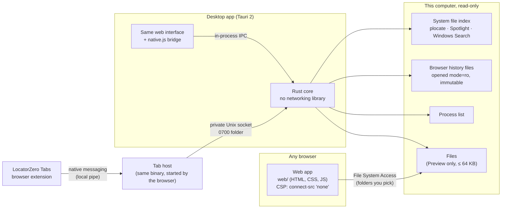

# Architecture

LocatorZero answers one question, **"where does it live?"**, and keeps one promise: **point, don't hold**. It
returns locations and metadata, never content, and keeps no copy of anything it finds.

The full design (C4 model, 26 decision records, NFR budgets) lives in the sibling repository
`locatorzero-architecture`. This page describes what is built.

## The pieces

| Piece | Path | Language | Role |
|---|---|---|---|
| Web app | `web/` | Plain JavaScript, no build step, no framework | The interface for both apps. On the web, searches demo data and folders you pick |
| Desktop shell | `desktop/src-tauri/` | Rust + Tauri 2 | Window, installers, and the bridge to the core |
| Core: sources | `src/sources/` | Rust | `files.rs` (system index), `history.rs` (Chromium-family and Firefox), `procs.rs` |
| Core: preview | `src/preview.rs` | Rust | One file, regular files only, ≤ 64 KB of text or one image ≤ 10 MB, buffer zeroed after |
| Core: hand-off | `src/reveal.rs` | Rust | Show in the file manager, or open a web address in the browser. Never launches the found file |
| Core: places | `src/places.rs` | Rust | Lists where you can search: home, cloud folders, connected USB, external and network drives |
| Core: tabs | `src/tabs.rs` | Rust | Native-messaging host and the open-tabs source |
| Core: licence | `src/licence.rs` | Rust | 90-day trial and offline Ed25519 key check |
| Extension | `extension/` | JavaScript, Manifest V3 | Sends open tabs (never private ones) to the tab host |
| Tools | `tools/issue-licence.mjs` | Node | Issues signed licence keys; runs where the private key is |

## One search, step by step (desktop)

0. **Consent first.** Nothing is searched until you allow it: "Everywhere" asks once (optionally remembered), and
   each drive or folder you pick from **Search in** asks every session. Drives the system index doesn't cover are
   listed into memory only after you allow them, and forgotten on wipe.
1. A keystroke updates the query; the interface searches anything already in memory **in the same frame**.
2. 60 ms after typing pauses, it calls the core's `locate` command with the enabled sources.
3. The core checks the licence, then asks four sources **in parallel**: system index (names first, whole path
   only if names run short), browser history (SQL `LIKE` with escaped wildcards), process list, and open tabs.
4. Every file result is checked against the disk, so a file deleted since the index last refreshed never shows.
5. The core overwrites its own copies of the query and returns locations with metadata. A result type has no
   field that can hold file content.
6. The interface merges and ranks the results (exact name, then prefix, then contains, plus recency; hidden
   folders and deep paths rank lower) and draws the list or the map.

## Where data lives

| Data | Where | How long |
|---|---|---|
| Query, results, previews, folder handles | Memory | Until close, Wipe, or 5 minutes idle |
| Open-tabs snapshot | Memory of the tab host | Until the browser closes |
| Theme and "tour seen" | Browser storage | Until you clear it |
| First-run date and licence key | `licence.json` in the app data folder | Until you remove it |
| Tab host registration | One small JSON per browser, written only when you press "Set up open tabs" | Until removed |
| **Anything about what you searched or found** | **Nowhere on disk** | — |

## Trust boundaries and how each is enforced

| Boundary | Enforcement | Verified by |
|---|---|---|
| App → internet | Web: CSP `connect-src 'none'`. Desktop: CSP allows only Tauri IPC, and no networking crate is compiled in | Live probe in the footer; `npm test`; `desktop/check-no-network.sh` (242 crates, none networked) |
| You → each place | A consent dialog before the first search of this computer and before any drive or folder; the folder picker is opened by the core, so the interface holds no file-system permission | Web tests: "choosing a folder asks for consent first"; `check-no-network.sh` fails if the interface is granted fs, shell or http permissions |
| App → your files | Read-only APIs only; preview refuses devices, pipes and folders | Unit tests; history file byte-identical after a read |
| Other programs → the core's memory | Linux: `PR_SET_DUMPABLE=0`: no core dumps, no same-user reads | `tests/measure-desktop.sh` reports the core as unreadable |
| Extension → app | Native messaging only to the registered host; socket in a 0700 folder, socket file 0600 | `tests/tabs_host.rs`, `tests/tabs-e2e.mjs` |
| Licence | Ed25519 signature check offline; public key only in the app | Unit tests: forged, foreign and expired keys refused |
| Page from host | `frame-ancestors 'none'`, `no-referrer`, `nosniff`, COOP/CORP, HSTS, Permissions-Policy denying camera, microphone, location and more | `curl -I` against the live site |

## Testing

| Suite | What | Command |
|---|---|---|
| Web end-to-end | 28 checks in headless Chromium against the real security headers, including "no network request while searching" | `npm test` (`BASE_URL=` for production) |
| Rust unit and integration | 24 checks + 1 benchmark | `cd desktop/src-tauri && cargo test --release` |
| Desktop smoke | Real app on a virtual display, typed with real keystrokes, screenshots | `tests/desktop-smoke.sh` |
| Licence flow | Trial ended → key issued → pasted → unlocked | `tests/desktop-licence.sh` |
| Open tabs | Real Chromium + extension + host | `node tests/tabs-e2e.mjs` |
| Measurements | Latency percentiles, memory, memory-wipe canary | [docs/measurements.md](docs/measurements.md) |
| CI | All of the above that runs headless, then installers for Linux, Windows and macOS | `.github/workflows/installers.yml` |

## Decisions that shaped this build

- **One interface for web and desktop.** The desktop build copies `web/` and adds `native.js`
  (`desktop/build-frontend.mjs`). One codebase to make premium, not two.
- **No framework, no build step for the web app.** Every script is first-party and auditable, which keeps a
  strict CSP possible: no inline scripts or styles at all.
- **The system's index, not our own.** Instant results without storing a copy of your file list (ADR-0005).
- **Webview interface, with its cost stated.** A webview made a premium interface fast to build, but it misses
  the idle-memory and memory-wipe budgets. A native Rust interface is the roadmap option if those budgets must be
  met.
