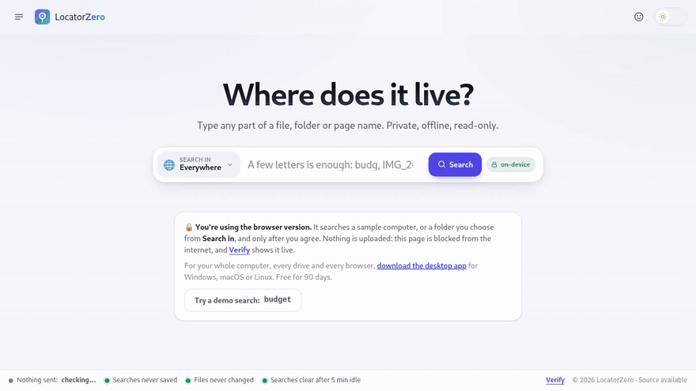
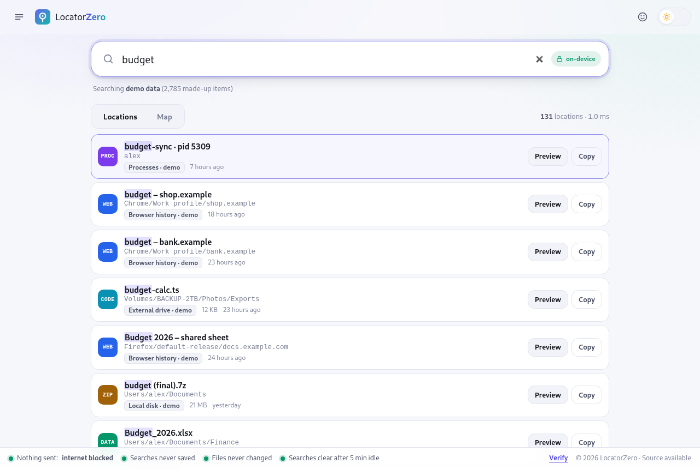
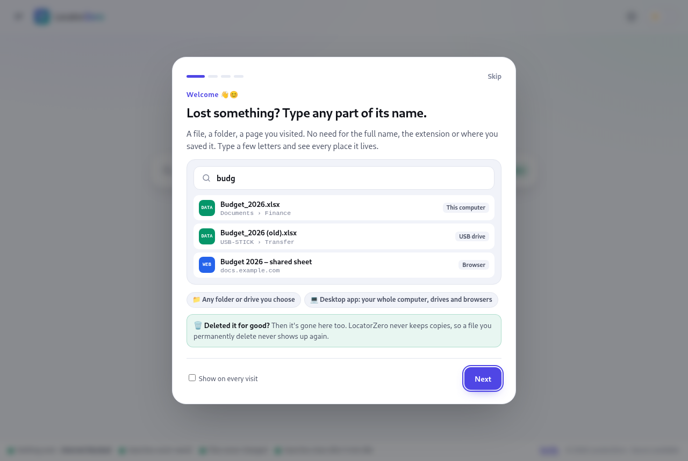
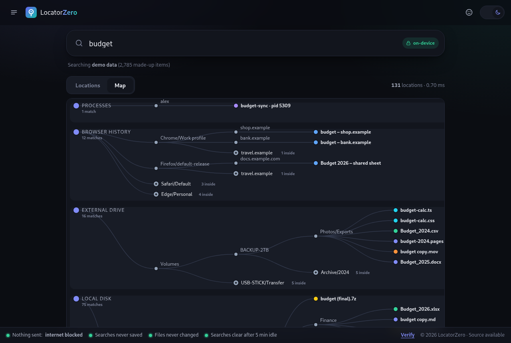
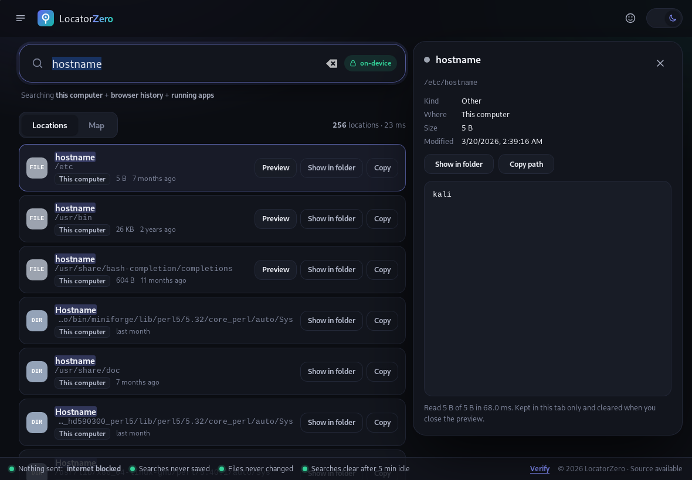
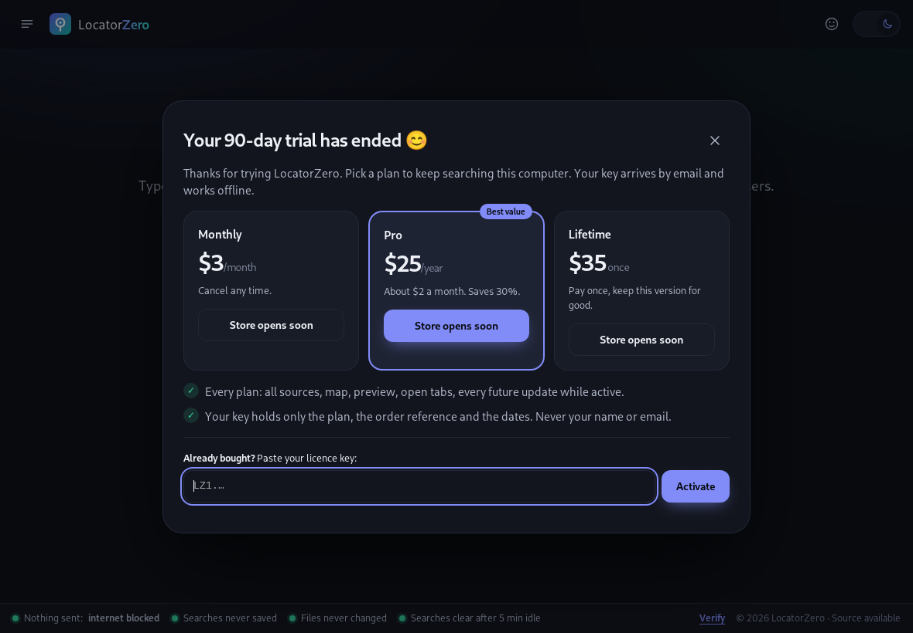
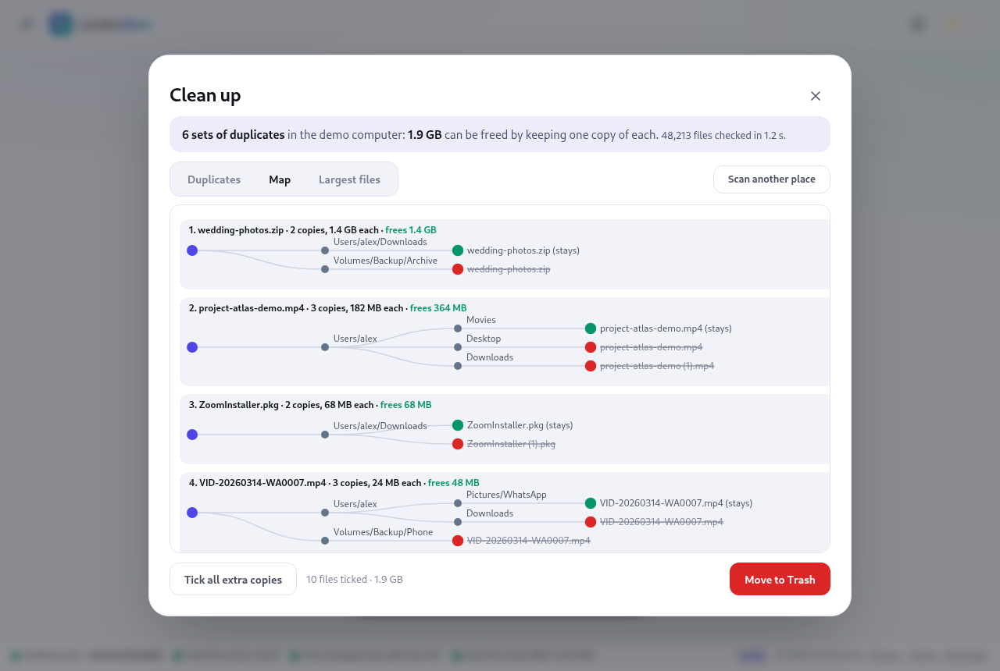
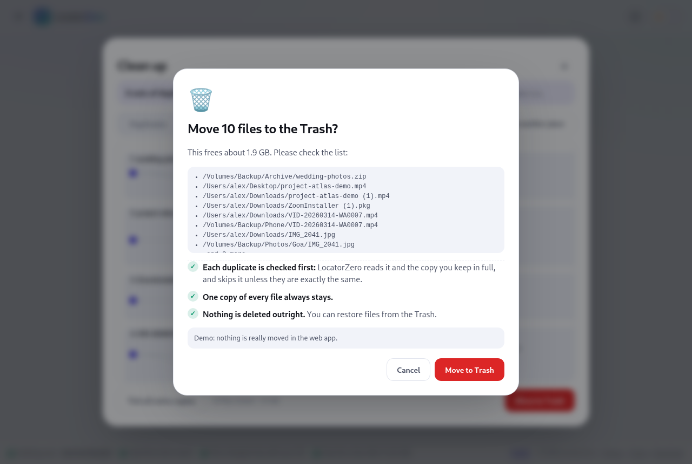

<p align="center"></p>

<h1 align="center">LocatorZero</h1>

<p align="center"><b>Lost something? Type any part of its name.</b><br>
See every place a file, folder, web page or open tab lives: this computer, external and USB drives, network
drives, cloud folders and every browser. Private, offline, read-only.</p>

<p align="center"><a href="https://locatorzero.pages.dev"><b>Try the web app →</b></a> &nbsp;·&nbsp; <a href="https://locatorzero.pages.dev/download"><b>Download for Windows, macOS, Linux →</b></a></p>

<p align="center"></p>

<p align="center"></p>

## Why it's different

| | LocatorZero | Your computer's search | Cloud search apps |
|---|---|---|---|
| Disk, drives, cloud folders and browsers in one search | ✅ | Mostly files | Online accounts |
| Works with no internet | ✅ | ✅ | ❌ |
| Keeps a copy of your data | **Never** | Its own index | On their servers |
| Map of where every copy is | ✅ | ❌ | ❌ |
| Privacy you can check in the app | ✅ Live checks | ❌ | ❌ |

## What you get

<table>
<tr>
<td width="50%"><br><b>A 30-second welcome</b> that shows, not tells, and ends with a one-click demo.</td>
<td width="50%"><br><b>Map view</b>: one lane per place things live. Folders open on click.</td>
</tr>
<tr>
<td><br><b>Desktop app</b>: whole-computer search through your system's own index, with preview and "Show in folder".</td>
<td><br><b>Fair pricing</b>: 90 days free, then a licence key that works offline.</td>
</tr>
<tr>
<td><br><b>Clean up</b>: every copy of a duplicated file on one map. Green stays, red goes to the bin, after you confirm.</td>
<td><br><b>Nothing moves without your OK</b>: a final check of what goes, and where it can be restored from.</td>
</tr>
</table>

- **A map even when nothing matches.** The Map tab then shows every place that was searched, each marked
  "no match", so you can see it really looked everywhere.
- **Instant.** Results paint 33 ms after a keystroke (median, web); the desktop searches four sources at once in
  33 ms (median). [Measured, misses included.](docs/measurements.md)
- **Every place.** Files and folders on internal, external, USB and network drives and in cloud-synced folders;
  history from Chrome, Edge, Brave, Vivaldi, Chromium and Firefox; open tabs (with the extension); running apps.
- **You choose where, and you're asked first.** The **Search in** menu inside the search field picks everywhere,
  your home folder, a USB, external or network drive, a cloud folder, or any folder. Each place asks for your OK
  before it is read.
- **Clean up (desktop).** Finds files stored more than once, and the biggest files, in a place you choose, in
  seconds, as a list or a map of every copy. You tick what goes; one copy of every file always stays. Nothing moves
  until you confirm, each duplicate is checked byte for byte first, and files go to the Recycle Bin or Trash, never
  deleted outright. Try it on demo files in the web app.
- **Deleted by mistake? (new in 0.3)** Search the Recycle Bin or Trash by name and see when each item was deleted
  and from where. **Restore** puts it back after you confirm, never overwriting anything. Two separate OKs: one to look
  in the bin, one for each restore. If a file skipped the bin, a help card says what to do on Windows, macOS and Linux.
- **Sort it out fast (new in 0.3).** Kind chips with counts above the results, **Group** by type, place or folder, and
  search tricks: `ext:pdf`, `size:>10mb`, `modified:week`, `type:image`.
- **Connected places (desktop, new in 0.3).** Every drive, USB stick, network and cloud folder with its free space and
  file system, one click from searching it. **Ctrl Shift Space** (⌘ Shift Space) opens LocatorZero from any app.
- **Preview on request.** One file at a time, at most the first 64 KB of text or one image.
- **Hand-off.** "Show in folder" opens your file manager; "Open" takes a web page back to your browser.
- **Light and dark**, keyboard-first (`/` jump to search, `Enter` search, `↑↓` then `Enter` preview, `1`/`2` tabs, `S` sidebar, `T` theme),
  and laid out for phones too.

## Privacy, as checks rather than claims

The footer is always visible: **Nothing sent: internet blocked · Searches never saved · Files changed only with your OK ·
Searches clear after 5 min idle**. Press **Verify** and the checks run live.

- **Nothing sent.** The app's security policy blocks every network request, its own included. The desktop core
  contains no networking library, and the build fails if one is ever added.
- **Nothing kept.** What you search lives in memory and clears on close, on Wipe, or after 5 idle minutes.
- **Nothing changed without you.** Searching is read-only. Browser history files are left byte-for-byte unchanged
  (tested). Clean up moves a file to the Recycle Bin or Trash only after you tick it and confirm, and only if it is
  still an exact copy of the one you keep.
- **Deleted means gone.** A file you permanently delete never shows, even before your system's index catches up.

Full detail, including the two technical limits we haven't beaten yet: [PRIVACY.md](PRIVACY.md).

## Pricing

| Web app | Desktop trial | Monthly | Pro | Lifetime |
|---|---|---|---|---|
| Free | 90 days free | $3 / month | $25 / year | $35 once |

No account. After paying, you get your key at locatorzero.pages.dev/key (order number + email; stateless, see
`functions/api/licence-key.js`). It holds only the plan, the order reference and the dates, and is checked offline. The store opens soon; see [docs/pricing-and-selling.md](docs/pricing-and-selling.md).

## Source available, with caveats

The code is public to read at [github.com/joyfulmake/locatorzero-source](https://github.com/joyfulmake/locatorzero-source),
so anyone can verify the privacy promises. That is not the same as open source:

| You may | You may not |
|---|---|
| Read, build and audit the code | Redistribute it, or a modified version, in source or built form |
| Test it for security and privacy, and publish findings in good faith | Remove or work around the trial or licence check |
| Use the desktop app free for 90 days, and the web app free | Offer it as a hosted service, or use it to build a competing product |

The full terms are in [LICENSE](LICENSE). It is a draft until reviewed by a lawyer.

## Download

**https://locatorzero.pages.dev/download.html**: Windows (`.exe`, `.msi`), macOS (Apple silicon and Intel `.dmg`)
and Linux (`.deb`, `.rpm`), each with its SHA-256 fingerprint. The page recommends the right file for your system.
The installers aren't code-signed yet, so Windows and macOS ask once on first launch; the page explains how.

To publish a new build: `tools/publish-downloads.sh` (fetches the latest successful CI build, writes checksums and
the page's manifest), then deploy the site.

## For developers

```bash
npm install && npm test                       # web app: 28 checks in headless Chromium
npm run serve                                 # http://127.0.0.1:8788 with production security headers

cd desktop/src-tauri
cargo test --release                          # Rust core: 24 checks
../check-no-network.sh                        # fails if any networking crate is compiled in
cargo tauri build --bundles deb,appimage      # Linux installers

cd ../.. && node tests/tabs-e2e.mjs           # real Chromium + extension + tab host
xvfb-run -a tests/desktop-smoke.sh hostname   # the real desktop app, driven by keystrokes
xvfb-run -a tests/desktop-licence.sh          # trial ended → key → unlocked
```

Deploy the web app: `wrangler pages deploy web --project-name locatorzero --branch main`.
Issue a licence key: `node tools/issue-licence.mjs --plan pro --ref ORDER-123` (needs the private key).
Update the public source mirror: `tools/sync-public-mirror.sh` (publishes HEAD under a neutral author; internal docs left out).

## Documents

| Read | For |
|---|---|
| [ARCHITECTURE.md](ARCHITECTURE.md) | How the pieces fit, where data lives, how each promise is enforced |
| [ROADMAP.md](ROADMAP.md) | What's done, the launch checklist, what's next |
| [PRIVACY.md](PRIVACY.md) | What the app and the store do with data |
| [SECURITY.md](SECURITY.md) | How to report a problem |
| [docs/measurements.md](docs/measurements.md) | Every performance and privacy budget against what was measured |
| [docs/pricing-and-selling.md](docs/pricing-and-selling.md) | Plans, licence keys, selling without keeping data, legal checklist for purchases |
| [extension/README.md](extension/README.md) | Installing the open-tabs extension |

---

© 2026 LocatorZero. Source available under the [LocatorZero Source-Available License](LICENSE).
